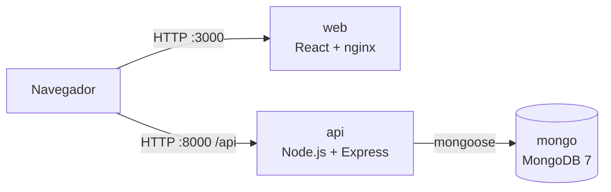

# Oxygen

Oxygen es una aplicación web para registrar tus desplazamientos diarios (coche, autobús, tren, bicicleta o a pie) y calcular la huella de carbono que generan. Se usa como proyecto de ejemplo en los cursos de DevOps y de Puesta en Producción Segura: es pequeña, pero tiene un frontend, una API, una base de datos y autenticación con JWT, que es justo lo que hace falta para construir un pipeline completo.

## Arquitectura



| Componente | Carpeta | Tecnología | Puerto |
| --- | --- | --- | --- |
| Frontend | `Oxygen8/` | React 18 (Create React App), React Bootstrap, axios | 3000 |
| API | `Oxygen8Service/` | Node.js 22, Express 5, mongoose, JWT, bcrypt | 8000 |
| Base de datos | — | MongoDB 7 | 27017 (solo red interna) |

El navegador habla con la API directamente. Por eso la URL de la API (`REACT_APP_API_ENDPOINT`) tiene que ser una dirección que el **navegador** pueda alcanzar, y se incrusta en el JavaScript al compilar el frontend.

## Estructura del repositorio

```text
oxygen/
├── Oxygen8/                  Frontend React
│   ├── public/               index.html, imágenes, consejos.json
│   ├── src/
│   │   ├── pages/            HomePage, LoginPage, ActivityDetailPage
│   │   ├── components/       Login, AddUser, AddActivity, Navigation…
│   │   └── context/          UserContext (sesión) y TuHuellaContext (actividades)
│   ├── Dockerfile            Build con Node y servido con nginx sin privilegios
│   └── nginx.conf
├── Oxygen8Service/           API REST
│   ├── src/
│   │   ├── service.js        Arranque, conexión a MongoDB y rutas
│   │   ├── routes/           /api/users, /api/auth, /api/activities, /api/transportTypes
│   │   ├── services/         Lógica de negocio
│   │   ├── models/           User, useractivity, transporttype
│   │   └── utils/            Tokens JWT, validadores, errores
│   ├── ejemplos/             Datos de ejemplo (tipos de transporte)
│   └── Dockerfile
├── docker/mongo-init/        Datos iniciales que carga MongoDB en el primer arranque
├── compose.yaml              Los tres servicios juntos
└── .env.example              Plantilla de variables de entorno
```

## Funcionalidad

- Registro de usuario e inicio de sesión. La contraseña se guarda con bcrypt y la sesión es un token JWT que el frontend guarda en `sessionStorage`.
- Alta de actividades: tipo de transporte, distancia y fecha.
- Consulta de actividades por día y cálculo de la huella según el factor de cada transporte.
- Consejos de sostenibilidad (`Oxygen8/public/consejos.json`).

## Configuración

Todas las variables se definen en un fichero `.env` en la raíz. Parte de `.env.example`:

```bash
cp .env.example .env
```

| Variable | Usada por | Para qué sirve | Ejemplo |
| --- | --- | --- | --- |
| `MONGODB_USER` / `MONGODB_PASS` | mongo, api | Usuario administrador de MongoDB | `oxygen` / *(una contraseña larga)* |
| `JWT_SECRET_KEY` | api | Firma de los tokens de sesión | salida de `openssl rand -hex 32` |
| `JWT_EXPIRE_TIME` | api | Caducidad del token | `1h` |
| `REACT_APP_API_ENDPOINT` | web (al compilar) | URL de la API vista desde el navegador | `http://localhost:8000/api` |
| `WEB_PORT` / `API_PORT` | compose | Puertos publicados en tu máquina | `3000` / `8000` |

`compose.yaml` fija además `MONGODB_URI=mongodb://mongo:27017/oxygen` y `MONGODB_AUTHSRC=admin` para la API.

> `.env` está en `.gitignore`. No lo subas nunca al repositorio.

## Lanzar con Docker (recomendado)

Requisitos: Docker Engine 24 o superior con el plugin Compose (`docker compose version`).

```bash
git clone https://github.com/cidinene/oxygen.git
cd oxygen
cp .env.example .env              # edita las contraseñas y el secreto JWT
docker compose up -d --build
docker compose ps                 # mongo debe estar "healthy"
```

Después:

1. Abre <http://localhost:3000>.
2. En la pantalla de acceso, cambia a «registro» y crea un usuario: nombre de al menos 3 caracteres y contraseña de al menos 6.
3. Inicia sesión y registra tu primera actividad.

También puedes crear el usuario con la API:

```bash
curl -X POST http://localhost:8000/api/users/addUser \
  -H "Content-Type: application/json" \
  -d '{"username":"ana","password":"secreto123"}'
```

### Comandos útiles

| Acción | Comando |
| --- | --- |
| Ver los logs de la API | `docker compose logs -f api` |
| Reconstruir tras cambiar código | `docker compose up -d --build` |
| Parar sin borrar datos | `docker compose down` |
| Parar y **borrar la base de datos** | `docker compose down -v` |
| Abrir una consola de MongoDB | `docker compose exec mongo mongosh -u "$MONGODB_USER" -p --authenticationDatabase admin oxygen` |

### Desplegar en otra máquina

Si los contenedores corren en un servidor (por ejemplo `pps-dev.aula.lan`), el navegador no puede usar `localhost` para llegar a la API. Cambia la URL en `.env` y reconstruye el frontend:

```bash
REACT_APP_API_ENDPOINT=http://pps-dev.aula.lan:8000/api
docker compose up -d --build web
```

### Qué hace cada imagen

- **`Oxygen8Service/Dockerfile`**: instala solo dependencias de producción con `npm ci --omit=dev` y ejecuta la API con el usuario `node`, sin root, en el puerto 8000.
- **`Oxygen8/Dockerfile`**: compila React en una etapa con Node y copia solo la carpeta `build` a `nginx-unprivileged`, que escucha en el 8080 sin root. `nginx.conf` redirige cualquier ruta a `index.html` para que funcionen las URL de React Router, como `/actividad/2026-10-20`.
- **MongoDB** no publica puertos: solo la API llega a ella, por la red interna de Compose. Al crearse el volumen por primera vez carga los tipos de transporte de `docker/mongo-init/`.

## Lanzar en local sin Docker

Requisitos: Node.js 22 y un MongoDB accesible. Lo más sencillo es arrancar solo la base de datos con Compose: `docker compose up -d mongo` y añadir `ports: ["27017:27017"]` al servicio, o usar un MongoDB instalado en tu equipo.

**1. API** — crea `Oxygen8Service/.env`:

```bash
PORT=8000
MONGODB_URI=mongodb://localhost:27017/oxygen
MONGODB_USER=oxygen
MONGODB_PASS=cambia-esta-contraseña
MONGODB_AUTHSRC=admin
JWT_SECRET_KEY=cambia-este-secreto
JWT_EXPIRE_TIME=1h
```

```bash
cd Oxygen8Service
npm ci
npm start                         # Oxygen8 Service listening at http://localhost:8000
```

Si tu MongoDB está vacío, carga los tipos de transporte una vez:

```bash
mongosh "mongodb://localhost:27017/oxygen" -u oxygen -p --authenticationDatabase admin \
  docker/mongo-init/01-transporttypes.js
```

**2. Frontend** — en otra terminal:

```bash
cd Oxygen8
npm ci
REACT_APP_API_ENDPOINT=http://localhost:8000/api npm start    # abre http://localhost:3000
```

## API

Todas las rutas cuelgan de `/api`. Solo las marcadas con 🔒 exigen la cabecera `Authorization: Bearer <token>` y el rol indicado; el resto son públicas.

| Método | Ruta | Descripción |
| --- | --- | --- |
| POST | `/users/addUser` | Crea un usuario |
| GET | `/users/:userId` | 🔒 admin · Datos de un usuario |
| POST | `/users/deleteUser` | 🔒 admin · Borra un usuario |
| POST | `/auth/login` | Devuelve el usuario y un token JWT |
| POST | `/auth/logout` | Cierra la sesión |
| GET | `/transportTypes/getAll` | Tipos de transporte y su factor |
| GET | `/activities/getAll/:userId` | Actividades de un usuario |
| GET | `/activities/getActivity/:activityId` | Una actividad |
| POST | `/activities/addActivity/:userId` | Crea una actividad |
| DELETE | `/activities/deleteActivity/userId/:userId/activityId/:activityId` | Borra una actividad |

## Tests

```bash
cd Oxygen8
CI=true npm test
```

> **Estado actual:** los tests del frontend no pasan. `App.test.js`, `Login.test.js` y `AddUser.test.js` renderizan los componentes sin sus *providers* de contexto, `axios-mock-adapter` no está en las dependencias y react-router 7 necesita `TextEncoder` en Jest. Arreglarlos es un buen primer ejercicio antes de añadirlos al pipeline de CI.

La API no tiene tests todavía; `jest`, `supertest` y `mongodb-memory-server` ya están en sus dependencias para escribirlos.

## Avisos de seguridad

Oxygen es un proyecto de aprendizaje y **no está preparado para producción tal cual**. Varios de estos puntos se trabajan en los laboratorios del curso:

- `service.js` escribe en el log la URI y el usuario de MongoDB al arrancar.
- `cors()` sin opciones acepta peticiones de cualquier origen.
- El token JWT se guarda en `sessionStorage`, accesible desde JavaScript si hay un XSS.
- Las rutas de `/api/activities` y `/api/transportTypes` no exigen token: cualquiera que conozca un `userId` puede leer o crear actividades de otro usuario (control de acceso roto / IDOR).
- Las dependencias tienen avisos de `npm audit` pendientes.
- En los ficheros de rutas, `router` se declara como variable global, y la ruta `updateactivity` tiene una comilla de más en su patrón.

## Licencia y uso

Proyecto docente de ejemplo para clases de DevOps y DevSecOps.

## Autores
Sergio Charro